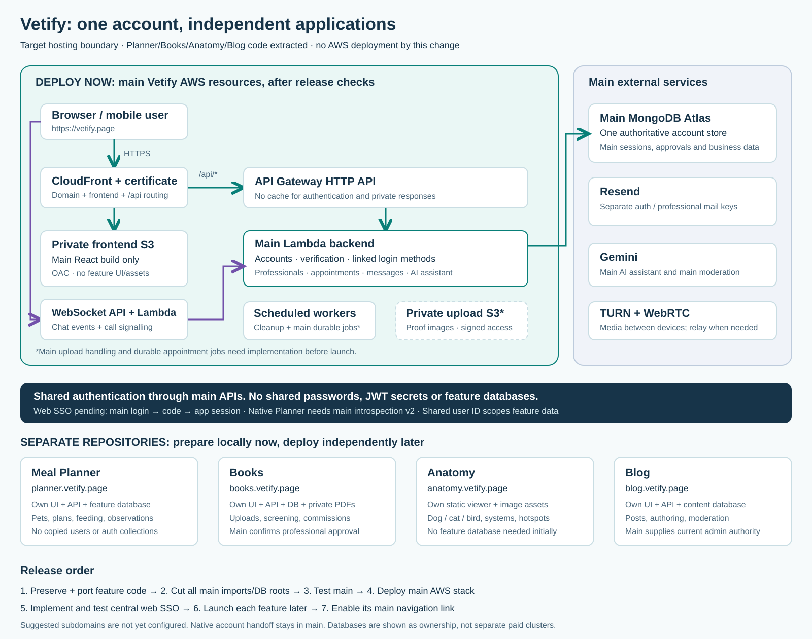
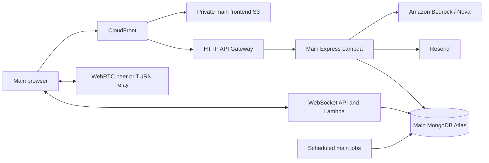

# Main Vetify architecture

Reviewed 25 October 2026. This is main's architecture and its external interfaces.
Independent feature implementation details live in their own repositories.

The picture is a target boundary, not proof of extraction or AWS deployment.

## Main runtime

Only signalling/presence/message events travel through the WebSocket API.
WebRTC media uses the peer/relay connection. Scheduled Lambda maintenance runs
appointment jobs. Professional proof photos upload separately to private MongoDB
drafts before application submission, keeping individual requests below Lambda's limit.
Local development uses Vite's proxy and persistent Socket.IO instead of gateways.

## Ownership

| Main component        | Owns                                                                     |
| --------------------- | ------------------------------------------------------------------------ |
| Identity              | Users, passwords, provider links, verification/recovery and sessions     |
| Professional services | Applications, proof, approval, profiles and discovery                    |
| Consultations         | Appointment state, slots, reminders, reviews and call rights             |
| Communications        | Conversations, messages, notifications and realtime leases               |
| AI guidance           | Kupa validation, semantic scope policy, allowance, provider and activity |
| Administration        | Account controls, application decisions, main audits/metrics             |

External Planner, Books, Anatomy and Blog have separate feature data and hosting.
They receive identity/capabilities via main APIs, not direct main database access.
The actual Blog sibling folder is `vetify-blogs`; its proposed public host is
`blog.vetify.page`. Future destinations are not yet DNS or deployment facts.

## Key source locations

- `src/client/App.tsx`: main routes, public Planner app page and external feature launch pages.
- `src/client/routes/console-routes.tsx`: professional/admin console routes.
- `src/server/app.ts`: Express composition and request middleware.
- `src/server/index.ts`: local listen/startup and interval jobs.
- `src/server/routes/v1/`: versioned main HTTP API composition.
- `src/server/models/`: typed Mongo collections, queries and indexes.
- `src/server/realtime/`: local events, Gateway delivery, durable sessions/calls.
- `src/server/lambda/`: HTTP, WebSocket and maintenance adapters.
- `src/shared/`: shared validation, account, realtime, and Kupa contracts.
- `deploy/serverless/template.yaml`: main backend SAM resources.
- `scripts/build-lambda.mjs`: bundled handlers and runtime dependency lockfile.

## Authentication boundary

Main browser refresh credentials remain host-only and HttpOnly. Native/Planner
session handoff and account QR also belong to main. Matching provider emails do
not automatically merge accounts; linking authenticates ownership explicitly.
Optional Anatomy/Books web sign-in uses registered OIDC callbacks, authorization
codes, PKCE, and app-specific sessions. Books worker capabilities use a separate
service credential. Keep main signing/social secrets private. Native introspection
is version 1; Planner's required version 2 remains pending coordinated work.
See [the central contract](main-deployment/shared-auth.md).

Kupa classifies message meaning before generating a reply, using the same scope
policy for both calls. Pet/veterinary questions and brief greetings are allowed.
Programming and unrelated tasks are declined. See [Kupa](main-deployment/bedrock-chat.md).

## Main-only deployment boundary

Books/Anatomy feature code and assets are removed. `/books` redirects to the
configured Books app. Professional management links retain console role guards.
Anatomy validates the main session and opens the separate app; its hosted path
coordinates an external viewer frame using origin-checked messages.
Blog has public/article/admin launch pages and no embedded implementation. Planner has a public app page;
its feature implementation, data APIs and indexes have been removed.
Deleting only navigation or documentation does not separate them.
Main account export and dashboard metrics no longer read migrated feature data.
Feature indexes and the Books worker/scanner are removed. Preserve shared native auth, region
helpers and professional MediaPipe proof while removing feature-specific roots.
See [the extraction checklist](main-deployment/extraction-checklist.md).

Main should remain usable while external features are down. Blank Books/Blog
destinations show unavailable states. Anatomy defaults to its production origin
when blank, with a localhost default in development; it has separate retry and
authentication handling. Optional feature aggregates cannot block admin pages.
Retain immutable main user IDs during any reviewed feature-data migration.

For the exact AWS order, use [the deployment guide](main-deployment/README.md).
