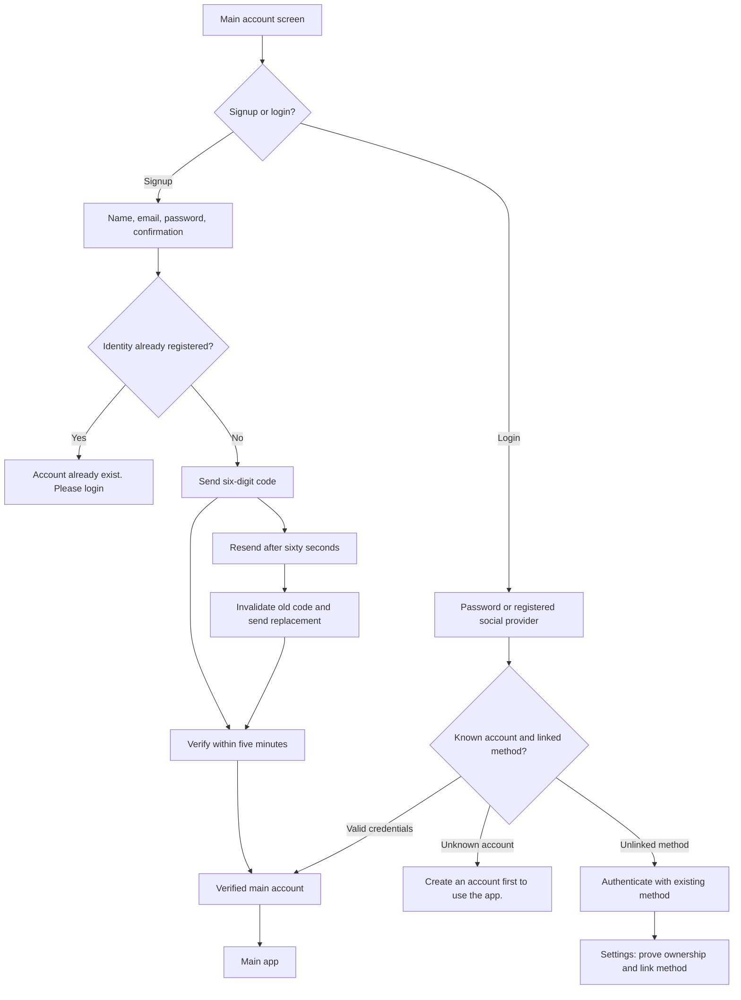
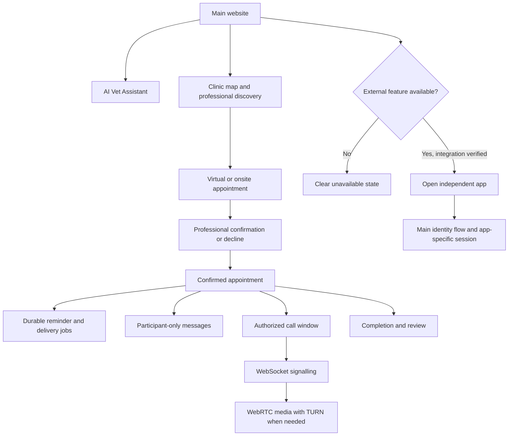

# Main Vetify user and deployment flows

Updated 14 October 2026. Diagrams describe main responsibilities; external-app
web SSO and main-only extraction remain pending implementation.

## Signup, login and linking

Failed code/credential/delivery checks remain on a visible retry/error state.
Unverified, blocked, revoked or deactivated accounts cannot bypass access checks.

## Main consultations and external launches

Cancelled/declined appointments follow their allowed transitions and do not gain
call access. External sites own their feature workflows and data.
See [architecture](architecture.md) and [central auth](main-deployment/shared-auth.md).
