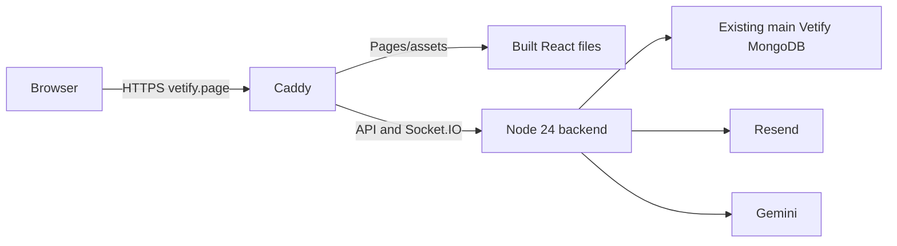

# Vetify first deployment: Lightsail

For `vetify.page`, one Ubuntu server runs the Node API, Socket.IO and existing scanners. Caddy serves React and manages HTTPS. MongoDB remains in your existing Atlas project. This replaces the earlier Fargate/CloudFront proposal for this budget.

The 2 GB IPv4 Linux plan is currently $12/month, or $72 for six full months before extras. The $200 maximum credit balance includes credits that must first be earned. Check your account's credit eligibility and expiry. A free account plan can end after six months even with credits remaining.

Follow the guides in this exact order:

1. [Build the release on your Windows computer](01-local-release.md).
2. [Create the AWS instance, IP, firewall and DNS records](02-aws-and-dns.md).
3. [Upload and install the app on Ubuntu](03-server-install.md).
4. [Configure login/email, test, update and roll back](04-checks-and-updates.md).

## Files supplied

| Repository file                       | Purpose / server destination                                                          |
| ------------------------------------- | ------------------------------------------------------------------------------------- |
| `env.prod.example`                    | Private production config template; actual values go in `/etc/vetify/env.prod`        |
| `scripts/build-server.mjs`            | Bundles server/shared source and the PDF worker                                       |
| `scripts/build-client-prod.mjs`       | Builds frontend using only public settings from the selected production file          |
| `scripts/package-release.mjs`         | Creates `dist/vetify-release.tar.gz` without secret files or node_modules             |
| `scripts/smoke-server-build.mjs`      | Tests an isolated runtime install, PDF worker and temporary MongoDB                   |
| `deploy/lightsail/bootstrap.sh`       | Installs Node 24/Caddy and creates the service account                                |
| `deploy/lightsail/install-release.sh` | Installs a versioned release and restores the previous app release if readiness fails |
| `deploy/lightsail/verify.sh`          | Requires both HTTP health and connected MongoDB                                       |
| `deploy/lightsail/vetify.service`     | `/etc/systemd/system/vetify.service`                                                  |
| `deploy/lightsail/Caddyfile`          | `/etc/caddy/Caddyfile`                                                                |

The archive layout is `server/`, `public/`, and `config/`. Dependencies are installed on Ubuntu from the generated lockfile. Windows node_modules are never uploaded.

## Important boundaries

- These files prepare deployment; they do not create AWS resources or edit DNS.
- Local `.env` stays local. `NODE_ENV=production` disables the server's automatic local-file fallback.
- `env.prod` is ignored by Git. Only its `VITE_API_URL` and `VITE_CARTO_KEY` are used to build the frontend.
- Credentials for MongoDB, Gemini, mail and OAuth stay on the server, outside the public website directory.
- S3, Lambda, ECR, a load balancer, NAT gateway and Route 53 are unnecessary for this initial single-server setup.
- Your existing upload storage and Mongo-backed job claims remain in use. Large uploads do not pass through Lambda.
- One server is a starting deployment, not high availability. Restarts and deployments can interrupt chats/calls.
- Gemini, Resend, MongoDB and domain charges are outside AWS promotional credits.

## Source references

- [Lightsail prices](https://aws.amazon.com/lightsail/pricing/)
- [AWS credit activities](https://aws.amazon.com/blogs/aws/aws-free-tier-update-new-customers-can-get-started-and-explore-aws-with-up-to-200-in-credits/)
- [Account plan expiry](https://docs.aws.amazon.com/awsaccountbilling/latest/aboutv2/free-tier-plans.html)
- [NodeSource installation](https://github.com/nodesource/distributions)
- [Caddy installation](https://caddyserver.com/docs/install)
- [Caddy automatic HTTPS](https://caddyserver.com/docs/automatic-https)
