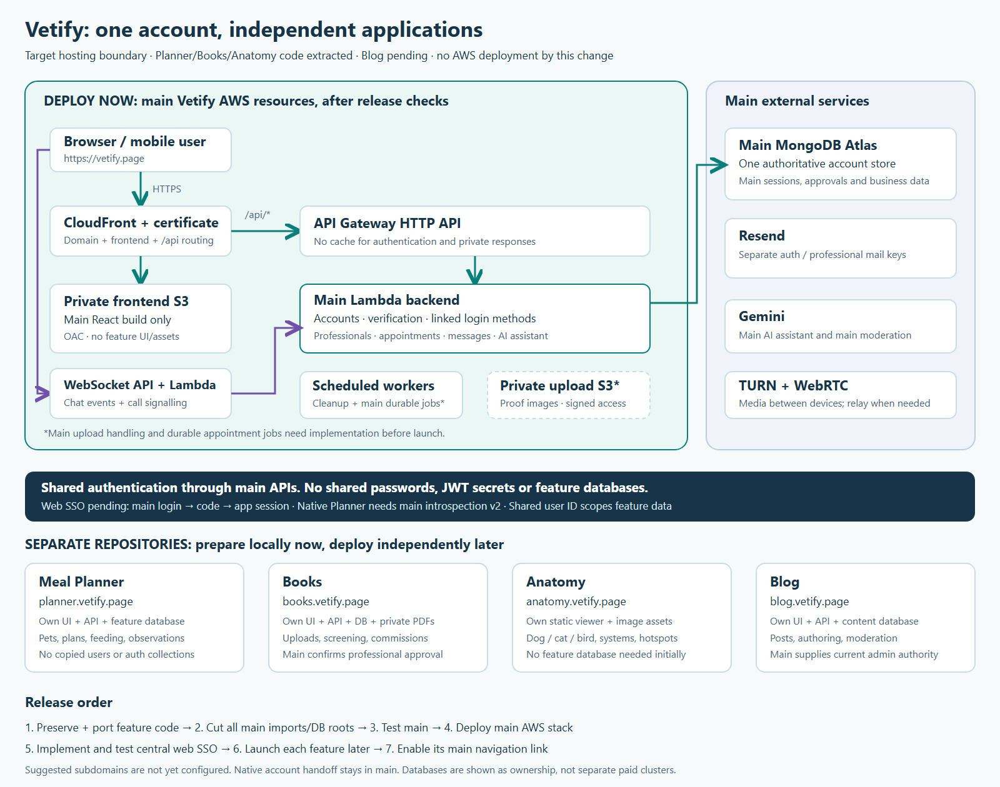

# Deploy main Vetify, extract four separate applications

This is an inspected deployment plan, not a completed extraction or AWS deployment.
Books/Anatomy code is removed from main and preserved in independent repositories.
Planner feature code is removed; `/planner` is a public app introduction.
The current builds still include Blog code.
Do not upload them as a main-only release until the extraction checks pass.

## Scope agreed with the owner

| Application  | Suggested repository       | Suggested address             | Data owner                                                        |
| ------------ | -------------------------- | ----------------------------- | ----------------------------------------------------------------- |
| Main Vetify  | Existing Vetify repository | `https://vetify.page`         | Accounts, professional approvals, appointments, messages          |
| Meal Planner | `vetify-meal-planner`      | `https://planner.vetify.page` | Pets, plans, feeding logs, nutrition observations                 |
| Books        | `vetify-books`             | `https://books.vetify.page`   | Documents, reviews, download allowances, commissions              |
| Anatomy      | `vetify-anatomy`           | `https://anatomy.vetify.page` | Static diagrams and hotspot content; no database needed initially |
| Blog         | `vetify-blogs`             | `https://blog.vetify.page`    | Posts, moderation decisions and content audit history             |

The four subdomain names are proposals. No DNS records or resources were created.
AI Vet Assistant remains in main Vetify. Books means the document library, not
appointment booking. Appointments, chat between users, calls, the clinic map,
professional onboarding, settings and account administration remain in main.

## Picture

Editable version: [architecture.svg](architecture.svg).
Boxes below the main deployment boundary are future, independently deployed apps.
Only accounts are shared through main authentication APIs. Databases are not shared.

## Start here

1. Read [the extraction checklist](extraction-checklist.md). It identifies the
   dependencies that make immediate deletion unsafe.
2. Use the existing sibling feature repositories. Their descriptions and setup
   prompts belong there. Preserve actual code/assets; a prompt cannot recover them.
3. Preserve and validate each extracted feature before removing its main roots.
4. Verify the main-only release, then follow [AWS preparation](aws-prepare.md)
   and [AWS deployment](aws-deploy.md).
5. Deploy only main now. A feature link without a deployed destination should
   show an unavailable state, rather than open an unconfigured website.
6. Coordinate Planner's version 2 introspection requirement and implement/test
   [central web authentication](shared-auth.md) before enabling external apps.

## Feature documentation locations

- `../vetify-meal-planner/docs/DESCRIPTION.md`
- `../vetify-books/docs/DESCRIPTION.md`
- `../vetify-anatomy/docs/DESCRIPTION.md`
- `../vetify-blogs/docs/DESCRIPTION.md`

These paths are relative to the main repository root; the folders are siblings.
Setup prompts stay in those repositories too. Main keeps only its integration
boundary, extraction work and central authentication requirements.

## What was checked

The plan was checked against the existing frontend routes, API mounts, shared
schemas, model indexing, Lambda build, authentication introspection, Books
approval checks, Anatomy rendering and local background scanners.
Main currently imports the Blog frontend and mounts its APIs. Books and
Anatomy have external launch pages; the Books worker, scanner and indexes are removed.
See [the completed extraction record](books-anatomy-extraction.md).
Planner has a public app page, with its data API/models removed. See
[the Planner page and extraction record](meal-planner-app-page.md).

Books/Anatomy extraction has targeted main regression and packaged-runtime checks.
The new shared web sign-in flow and main-only package must receive their own
tests before deployment. No actual environment file, account, database data or
AWS resource was modified during Books/Anatomy extraction.
